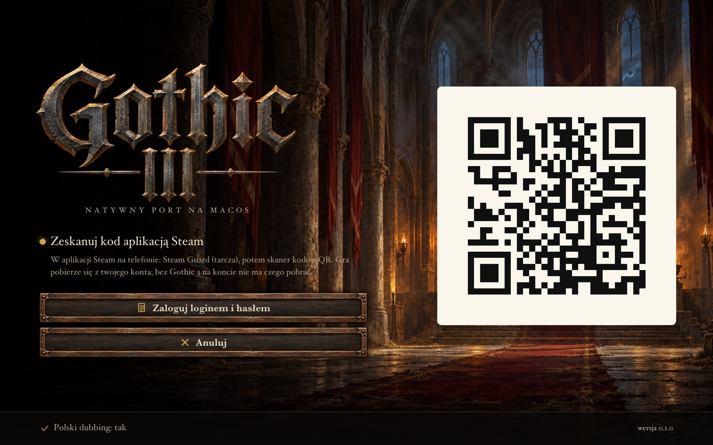
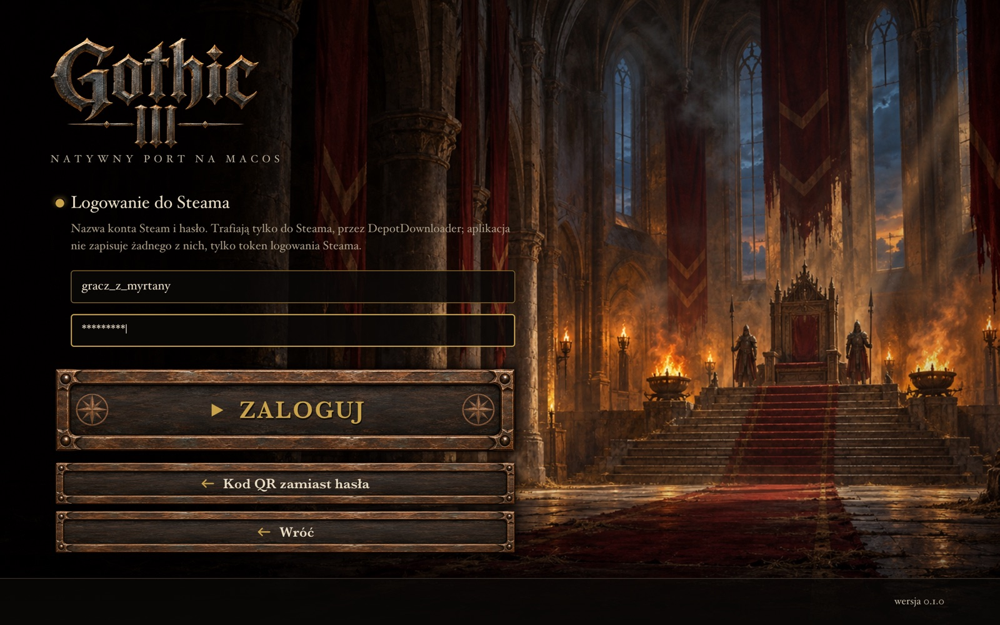
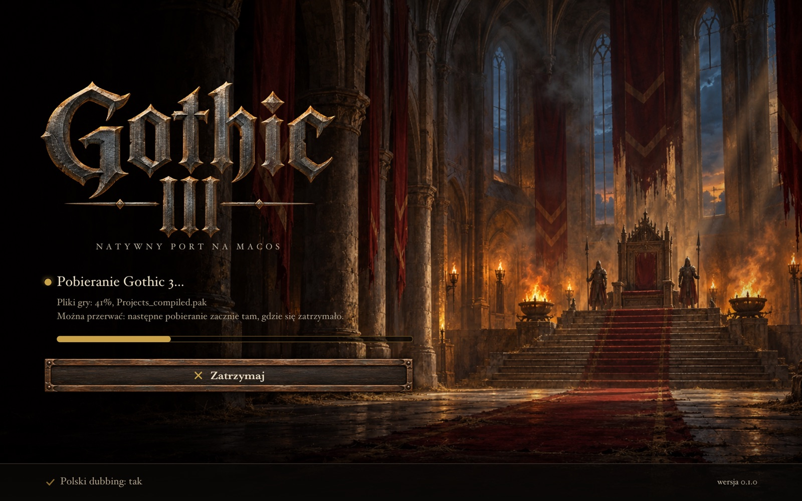
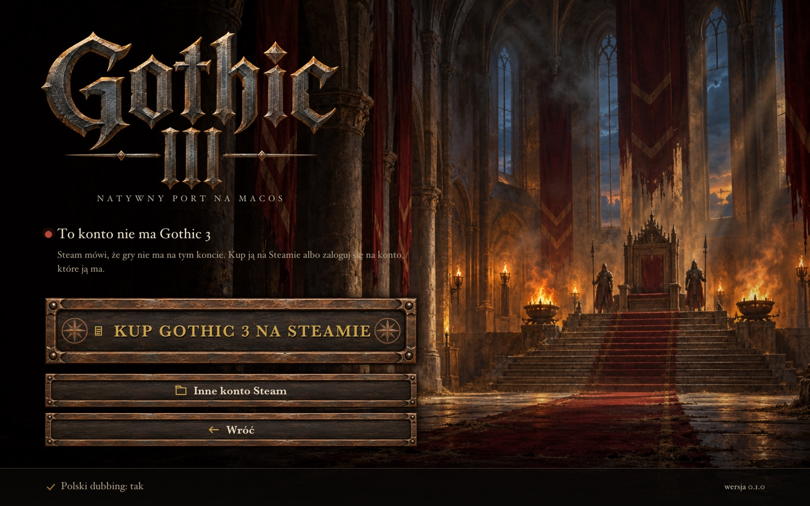
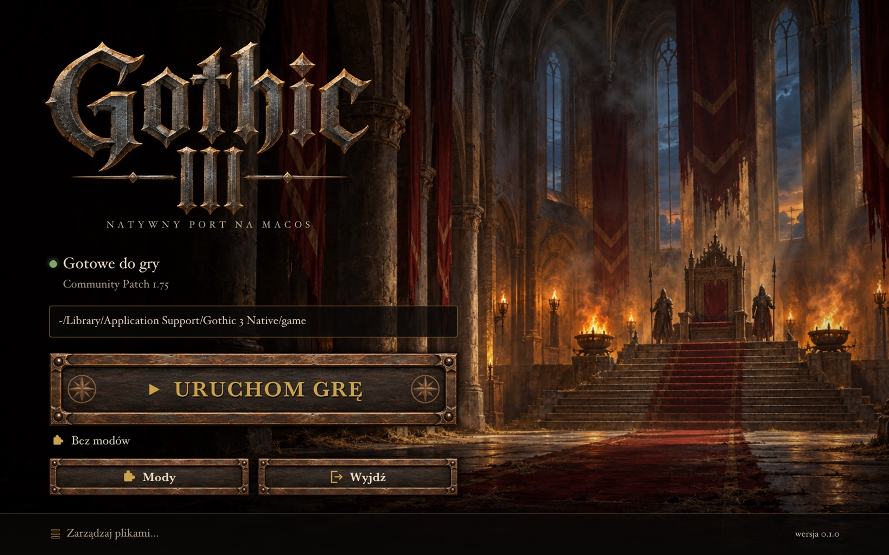
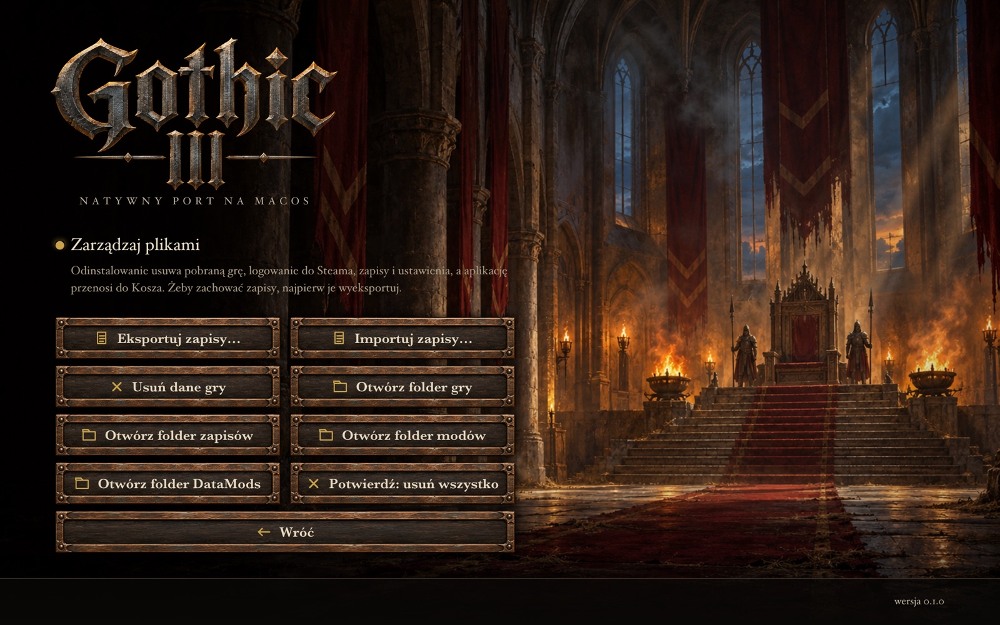

# Gothic 3 na Maca

Natywny port Gothica 3 (Community Patch 1.75.14) na komputery Mac z procesorem Apple (M1 i nowsze). Kod gry został
przetłumaczony z 32-bitowego Windowsa na arm64, a grafika idzie przez Metal. Bez Wine, bez emulatora, bez
Rosetty.

Aplikacja nie zawiera plików gry. Pobiera je z twojego konta Steam, więc musisz mieć tam kupionego Gothica 3.
Projekt nie ma nic wspólnego z THQ Nordic, Piranha Bytes, JoWooD ani Valve.

## Czego potrzebujesz

- Maca z Apple Silicon (M1, M2, M3, M4) i macOS 13 albo nowszego.
- Gothica 3 na koncie Steam ([strona w sklepie](https://store.steampowered.com/app/39500/)). Steam na Maca nie jest
  potrzebny.
- Około 5 GB wolnego miejsca.
- Do logowania kodem QR: aplikacji Steam na telefonie. Bez niej zalogujesz się loginem i hasłem.

## Instalacja

1. Pobierz `Gothic3-Mac-<wersja>.dmg` z [wydań](https://github.com/kordit/gothic3-mac/releases).
2. Otwórz DMG i przeciągnij `Gothic3Recomp` do folderu `Aplikacje`.
3. Uruchom `Gothic3Recomp` z Aplikacji. Za pierwszym razem macOS go zablokuje, bo aplikacja nie jest
   notaryzowana przez Apple. Wejdź wtedy w Ustawienia systemowe > Prywatność i ochrona, przewiń w dół i kliknij
   „Otwórz mimo to”. Potem uruchom jeszcze raz. (Albo w Terminalu:
   `xattr -dr com.apple.quarantine /Applications/Gothic3Recomp.app`.)

## Pierwsze uruchomienie

### 1. Logowanie do Steama

Launcher od razu łączy się ze Steamem i pokazuje kod QR.

Na telefonie otwórz aplikację Steam, stuknij tarczę (Steam Guard) i wybierz skaner kodów QR. Zeskanuj kod z
ekranu i potwierdź logowanie.

Na dole jest przełącznik „Polski dubbing”. Domyślnie jest włączony. Jeśli wolisz angielskie głosy (i o 1 GB
mniej do pobrania), kliknij go przed pobraniem, a zmieni się na „nie”. Napisy i teksty i tak są po polsku.

Nie masz aplikacji Steam na telefonie? Kliknij „Zaloguj loginem i hasłem”.

Wpisz nazwę konta Steam i hasło, a potem kliknij „Zaloguj”. Steam może poprosić o kod Steam Guard z aplikacji
albo z maila: launcher pokaże wtedy pole na kod. Hasło trafia tylko do Steama, przez
[DepotDownloader](https://github.com/SteamRE/DepotDownloader). Aplikacja zapamiętuje token logowania Steama,
nigdy hasła, więc przy następnym uruchomieniu nie trzeba logować się ponownie.

### 2. Pobieranie

Launcher pobiera Gothica 3 z Community Patchem 1.75.14 (gałąź `cpt_1.75_testbranch` na Steamie, ok. 3,3 GB)
i polski dubbing (ok. 1 GB). Pobieranie można zatrzymać przyciskiem „Zatrzymaj” albo po prostu zamknąć
aplikację. Następne uruchomienie dokończy je od miejsca, w którym stanęło.

Jeśli na koncie nie ma Gothica 3, launcher to powie i nic nie pobierze:

„Kup Gothic 3 na Steamie” otwiera sklep, „Inne konto Steam” pozwala zalogować się na konto, które ma grę.

### 3. Gra

Po pobraniu launcher sam przygotowuje pliki (trwa to kilka sekund) i od razu uruchamia grę. Przy kolejnych
uruchomieniach widzisz ten ekran:

„Uruchom grę” startuje Gothica. „Mody” otwiera ekran modyfikacji z katalogu Sefaris Mod Managera, jeśli go masz.

## Aktualizacje

Przy każdym uruchomieniu launcher sprawdza, czy na GitHubie jest nowsze wydanie. Jeśli jest, na ekranie
głównym pojawi się przycisk „Aktualizuj do x.y.z”. Jedno kliknięcie pobiera nową wersję, podmienia aplikację
w Aplikacjach i uruchamia ją ponownie. Pobrana gra i zapisy zostają.

## Zapisy i odinstalowanie

„Zarządzaj plikami…” w dolnym pasku:

- „Eksportuj zapisy…” robi ZIP z zapisami i ustawieniami, „Importuj zapisy…” wczytuje taki ZIP.
- „Usuń dane gry” kasuje pobraną grę, a zapisy zostają.
- „Odinstaluj z tego Maca” (trzeba nacisnąć dwa razy) usuwa wszystko: pobraną grę, logowanie do Steama,
  zapisy, ustawienia i pamięć podręczną, a aplikację przenosi do Kosza. Jeśli chcesz zachować zapisy, najpierw je
  wyeksportuj.

Samo wyrzucenie aplikacji do Kosza zostawia grę i zapisy w `~/Library/Application Support/Gothic 3 Native`.

## Błędy

Jeśli coś nie działa, zgłoś to w [Issues](https://github.com/kordit/gothic3-mac/issues).

## Podziękowania

- Zespołowi Community Patcha za Community Patch 1.75.14.
- Autorom recomp-kit, zestawu do statycznej rekompilacji, na którym stoi ten port (`kit/`).
- SteamRE za DepotDownloadera i SteamKit2 (GPL-2.0; program jest w aplikacji razem z licencją).

---

## English

A native Apple Silicon port of Gothic 3 (Community Patch 1.75.14), made by static recompilation: no Wine, no
emulator. It contains no game files and downloads them from your own Steam account, so you need to own Gothic 3
there. Not affiliated with THQ Nordic, Piranha Bytes, JoWooD or Valve.

1. Open the DMG from [Releases](https://github.com/kordit/gothic3-mac/releases) and drag `Gothic3Recomp` to
   Applications. The app is not notarized: on the first start allow it in System Settings > Privacy &
   Security > Open Anyway.
2. Scan the QR code with the Steam mobile app, or log in with your account name, password and Steam Guard code.
   The password goes to Steam only, through DepotDownloader; the app keeps Steam's login token.
3. The launcher downloads the game (about 3.3 GB, plus 1 GB of Polish speech you can switch off), prepares it
   and starts it. Updates install from the launcher with one click. Manage files > Uninstall from this Mac
   removes everything.
